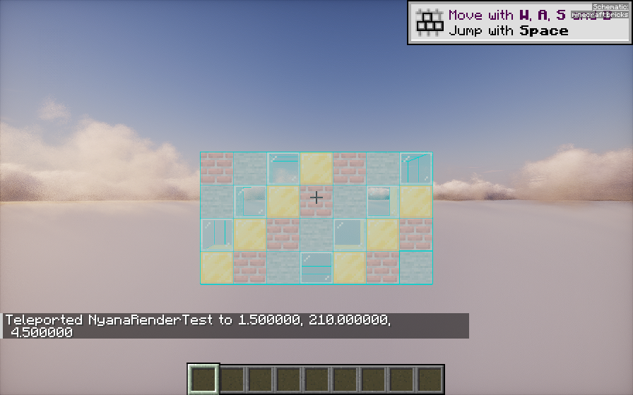

# Vulkan_For_Litematic（Fabric）

前置：[Aetherium 0.1.3（Fabric）](https://www.curseforge.com/minecraft/mc-mods/aetherium-vulkan-shader-mod/files/9545302) 和 [Sodium](https://modrinth.com/mod/sodium/versions?g=26.3) [Litematica 0.29.1](https://modrinth.com/mod/litematica/version/0.29.1) 和它的前置 [MaLiLib 0.30.2](https://modrinth.com/mod/malilib/version/0.30.2)。

游戏所用着色器为Vulkan

## 已知不支持

[SEUS PTGI / PTGI HRR](https://www.sonicether.com/seus/) 换谁来都不支持



<details>
<summary>原理和构建</summary>

Aetherium 扩展了地形顶点格式，Litematica 借这个格式写投影，却仍用自己的方块管线读取。补丁只让投影使用它自身管线的格式，不改游戏地形、差异层或光影合成。

用 Python 3 和 JDK 25，从已安装的 26.3 Fabric 客户端取编译依赖：

```sh
python build.py --minecraft-jar /path/to/minecraft-26.3.jar \
  --litematica-jar /path/to/litematica-fabric-26.3-0.29.1.jar \
  --libraries /path/to/.minecraft/libraries
```
</details>

## 多版本兼容

自己vibe coding一下就行了..我主要是自己跟好厚米玩用的 不长期维护
